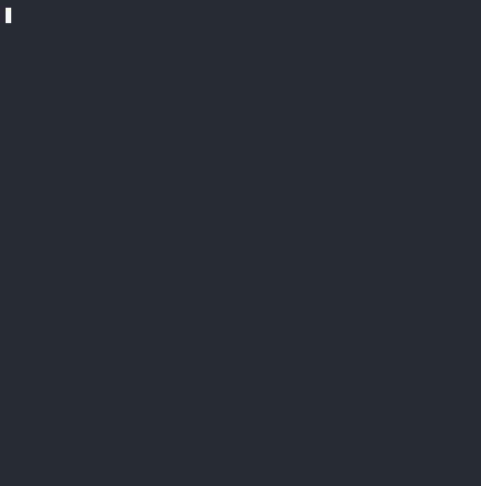

# WDC（Windows Developer Config）— 声明式 Windows 开发环境

> clone 之后一条命令，任何一台 Windows 机器一次性配置到声明状态：软件、系统设置、dotfiles、WSL Ubuntu。跑完即休眠，机器日常归你、漂移合法；想跟进新声明（更新）或收回声明状态（回归）时显式再跑——幂等、可重放（[ADR-0009](docs/adr/0009-oneshot-manual-update-reconverge.md)）。

[](https://github.com/yu-cn/wdc/actions/workflows/validate.yml)
[](LICENSE)

<p align="center">
  <a href="docs/demo.cast"></a>
</p>
<p align="center"><sub>↑ 速览：<code>wdc</code> 只读快照 · <code>wdc plan</code> 更新/回归前预演 · <code>wdc exit</code> 退出预览（非交互自动预演，零变更；源文件 <a href="docs/demo.cast">docs/demo.cast</a>）</sub></p>

这是作者的日常开发环境，以仓库形式维护：配置只描述「一台机器应当处于什么状态」，由 bootstrap 负责把机器收敛到这个状态。基于 [microsoft/WindowsDeveloperConfig](https://github.com/microsoft/WindowsDeveloperConfig) 的经验自建（不 fork，见 [ADR-0001](docs/adr/0001-own-tree-not-fork-upstream.md)）。仓库以 [MIT](LICENSE) 开源，欢迎直接使用或 fork 改造成你自己的环境（见「[使用与改造](#使用与改造)」）。**1.0.0 承诺面**：一次性配置 · 显式更新/回归 · 完整退出（`wdc exit`）· 漂移不纠察——机器日常归你；装完即走见「[一次性使用](#一次性使用外部用户装完即走)」。

## 快速开始（新机器）

零前置——Windows 10/11 自带的 winget 与 Windows PowerShell 足以启动，一条命令（cmd / PowerShell / Git Bash 均可粘贴）：

```powershell
powershell -c "irm https://raw.githubusercontent.com/yu-cn/wdc/main/scripts/get.ps1 | iex"
```

get.ps1 是唯一的远程引导脚本：缺 Git 自动 winget 安装（弹一次 UAC）→ 定位或 clone 仓库（`~/.wdc` 指针有效则复用，缺省 clone 到 `~\wdc`）→ 直接进入 bootstrap 全流程（缺 PowerShell 7 自动经 winget 用户级安装）。get.ps1 全程纯 ASCII（无 BOM），`irm | iex` 在裸机 Windows PowerShell 5.1 即安全——含中文的脚本不可走这条路（BOM 毒化实录见 [collaboration.md 已知坑16](docs/agents/collaboration.md)）。该命令属于直接执行网络代码——介意可先[审阅 get.ps1](scripts/get.ps1)再粘贴。求稳可先钉版本：`$env:WDC_TAG = 'v0.14.0'` 再执行同一条命令（clone 后 checkout 该 tag，仅作用于全新 clone；tag 清单见 [Releases](https://github.com/yu-cn/wdc/releases)）；fork 用户把地址指到自己的仓库：`$env:WDC_REPO = 'https://github.com/<你>/wdc.git'`——同样一条命令完成引导。偏好手动管理的等价三行（Git 需自备，`winget install Git.Git` 或官网安装包）：

```powershell
git clone https://github.com/yu-cn/wdc.git
cd wdc
powershell -ExecutionPolicy Bypass -File bootstrap.ps1
```

bootstrap 先确保 PowerShell 7 就位（裸机自动安装），再依次跑七个阶段（预检 → 无副作用校验 → 应用声明配置 → 用户级安装 → 移除清单 → WSL 侧 → dotfiles），全程输出分阶段报告。**一条命令一键收敛**：未提权启动会弹一次 UAC，提权子回合一回合跑完全部七阶段（含 WSL），无需手动二次运行。

> **直接在自己机器上跑之前先知道**：bootstrap 是作者环境的一次性收敛——会应用注册表系统设置（含关远程桌面等 opinion），并执行一份显式移除清单（[ADR-0007](docs/adr/0007-removal-list-converge-only.md)：卸载商店版 VSCode 换 winget 版、清理退役终端片段；**不卸载任何语言栈与已装软件**）。想用自己的偏好，建议先 fork 按下文「使用与改造」裁剪再跑。

<details>
<summary><strong>首次运行你需要配合的五件事</strong>（UAC 提权 · 重启续跑 · 填写身份 · 登录 VSCode 开同步 · CLI 装否选择）</summary>

1. **UAC 提权**——未提权启动会自动请求，点一次确认
2. **重启**——全新机器 bootstrap 会在提权回合内自动启用 WSL 并提示重启；重启登录后由一次性续跑任务**自动重跑** bootstrap 安装 Ubuntu 并收尾（GLOSSARY「续跑任务」：任意一次 bootstrap 启动即清除、绝不循环；自动登记未成时手工路径：重启后重跑 `bootstrap.ps1`，或管理员终端 `wsl --install`，流程相同）
3. **填写身份**——bootstrap 生成 `~/.gitidentity` 占位后，填上**本机**的 git name/email（各机身份不同；不填则 git 拒绝提交，这是防错护栏）
4. **登录 VSCode 开启设置同步**——首次启动 VSCode 登录账号并开启设置同步（齿轮/账户图标），扩展/设置/键位自动回来。WDC 只装本体：账号态归 VSCode 自己的同步机制，仓库管机器环境态（v1-program 工单03，2026-11-21 主人定夺全让位——对照上游 WindowsDeveloperConfig 同款边界：不装扩展、不碰 VSCode 配置文件）
5. **CLI 装否选择**——bootstrap 会问一次「是否把 `wdc` 命令装进 shell」（默认装；`-NoCli` 可预设跳过）。不装则 shell 配置零 WDC 痕迹，管理命令随时可从仓库脚本直接跑

</details>

重跑 bootstrap 幂等：已就位的全部跳过，只有漂移会被收敛——重跑即显式的「更新」（拉了新声明）或「回归」（漂移后收回敛，[ADR-0009](docs/adr/0009-oneshot-manual-update-reconverge.md)），平时 WDC 不碰机器；回归前建议先 `wdc plan` 预演（漂移积累越久，单次回归覆盖面越大）。收敛完成后验收：`pwsh scripts/verify-machine.ps1`（全绿即与声明一致）。`-NoElevate` 保留为非提权单回合入口（排障逃生通道：apply 与 WSL 启用受限跳过）。

<details>
<summary><strong>一条命令得到什么</strong>（点开看完整清单）</summary>

**系统**（[base-windows 域](configs/base-windows.winget)，27 项注册表 opinion）
开发者模式 · 启用 Sudo · 长路径 · 深色主题 · 显示扩展名/隐藏文件 · 资源管理器与任务栏去噪 · 开始菜单关 Web 搜索与推荐 · 关 Recall / Click To Do / 小组件 · Edge 新标签空白 · 关远程桌面

**CLI**（[cli-tools 域](configs/cli-tools.winget)，18 个 winget 包）
Git · GitHub CLI · Everything · PowerToys · lazygit · delta · fzf / fd / ripgrep / zoxide / bat / jq · make · Starship · VC++ 运行库 · JetBrainsMono NF 字体（PowerShell 7 由入口引导层负责安装与升级；浏览器不入声明——Edge 预装等价，Chrome 等属机器自留地，ADR-0003 第二轴）

**编辑器**（[editors 域](configs/editors.winget)）
VS Code 本体——扩展/设置/键位走 VSCode 原生**设置同步**（账号态，新机登录即回；ADR-0003 第二轴判例，WDC 不与原生机制打架）

**语言运行时**
Node 归 **mise**（默认 `node@lts` 随收敛更新）、Python 归 **uv**——Windows / WSL 两侧同工具同习惯

**WSL 侧**（Ubuntu——[setup-ubuntu.sh](scripts/wsl/setup-ubuntu.sh) 薄包装）
平台配置归 WDC（[ADR-0008](docs/adr/0008-wsl-platform-config-declared.md)）：`.wslconfig`（VM 形态——mirrored 网络 / dnsTunneling / 内存回收 / 稀疏 vhdx / virtiofs，核数与内存配额按机器事实公式渲染）+ `/etc/wsl.conf`（保护合并 `[boot]` systemd / `[user]` default，未管理段保护不碰）；发行版内环境委托姊妹仓库 [LDC](https://github.com/yu-cn/ldc)——apt 包 / gh / Docker Engine / uv / mise / Starship / Linux dotfiles / 默认 shell（单一实现，LDC-0007/0021）

**dotfiles**（[dotfiles/](dotfiles/)，渲染拷贝安装（[LDC ADR-0015](https://github.com/yu-cn/ldc/blob/main/docs/adr/0015-copy-render-not-symlink.md)），旧文件备份 `*.bak`）
gitconfig（delta / rerere / zdiff3）· starship.toml（pwsh / Git Bash / WSL bash 三 shell 统一提示符）· Windows Terminal · VS Code settings / keybindings · bashrc（Windows 侧；Linux bashrc 归姊妹仓库 LDC，工单32 起委托接管）· .wslconfig（模板在 dotfiles，机器派生值公式渲染归 lib/wslconfig.ps1，ADR-0008）

</details>

## 使用与改造

- **直接用**：照上文「快速开始」clone 本仓库跑 bootstrap。仓库不含作者的身份与机器派生值——`~/.gitidentity` 填你自己的 git name/email，WSL 终端配置按你本机发行版渲染（[ADR-0004](docs/adr/0004-machine-adaptive-rendering.md)）——之后想跟进上游演进时显式跑 `wdc sync`（手动更新，ADR-0009）。
- **fork 改造（推荐）**：fork 成你自己的仓库再 bootstrap（引导命令前设 `$env:WDC_REPO` 指向你的仓库即可，get.ps1 写死的是上游地址），偏好由你定。改造清单：
   1. `configs/*.winget`——软件清单，删你不用的（VSCode 扩展/设置归其原生设置同步，不入仓）
   2. `dotfiles/`——shell / git / 终端 / 编辑器偏好
   3. `LICENSE`——版权人换成你自己
   4. `.scratch/`——作者的内部工单流，可删可留（留作方法参考）
   5. `scripts/remove-leftovers.ps1`——移除清单（[ADR-0007](docs/adr/0007-removal-list-converge-only.md)：本仓自清理 + 迁移冲突，不卸语言栈），按你自己的迁移需求增删

  脚本里没有写死的仓库地址，fork 后无需改动即可 bootstrap；日后跟随上游演进的 recipe 见 [docs/forking.md](docs/forking.md)。例外：[scripts/get.ps1](scripts/get.ps1) 是面向上游的远程一键引导、写死上游地址——fork 用户走手动 clone 三行，或把它改成你的仓库地址再发布。

## 一次性使用（外部用户：装完即走）

只想配置这一次、之后 WDC 从你的生活里消失？三步：

1. **装**：照「快速开始」跑一行命令（全席：工具 + 终端体验 + 系统调优 + WSL）。首跑会问一次「是否把 `wdc` 命令装进 shell」——不装则你的 shell 配置零 WDC 痕迹（自动化预设：`bootstrap.ps1 -NoCli` / `-Cli`）；
2. **验收**：`pwsh scripts/verify-machine.ps1` 全绿；
3. **走**：`wdc exit -KeepTools`（清 WDC 机器状态与指针，环境原样保留）→ 删掉 clone 目录。

留下的只有装上的工具和渲染好的配置（都是机器自持的实体文件——ADR-0015 起**运行时不依赖仓库**，shell 配置对仓库缺席优雅降级）；WDC 的管理机构（仓库/账本/命令）归零。装进 shell 的 `wdc` 命令在删库后降级为一行提示语，无害；想清理可在删除 clone 前顺手 `wdc exit`（完整退出：声明包卸载/注册表还原/dotfiles 处置，[ADR-0010](docs/adr/0010-wdc-exit.md)）。

**想回来**：任何时候再跑同一行引导——全新 clone 后 bootstrap 幂等，已就位的全部跳过，分钟级通过。**想全退**：`wdc exit`（完整退出，还原基准见 [undo 表](docs/undo-table.md)）。

## 常用命令

| 命令 | 用途 |
| --- | --- |
| `wdc` | 只读快照（裸命令默认，秒级）：远端差距 / dotfiles 漂移 / 身份与 WSL / 最近 bootstrap；`-Json` 单行机器可读出口 |
| `wdc plan` | 干跑预演（只读零变更）：重跑 wdc sync 会做什么——会不会弹 UAC、走全量还是快速路径；更新/回归前的推荐步骤（ADR-0009） |
| `wdc sync` | 手动更新/回归入口（fetch → pull → bootstrap → verify -Quick 收尾；会请求一次 UAC；ADR-0009）。已收敛且声明未变（收敛账本=HEAD、工作区干净）走快速路径跳过 bootstrap，秒级完成；账本缺失/损坏或有新 pull 一律回退全量（宁可慢不可假绿），`-Full` 强制全量 |
| `wdc verify [-Full]` / `wdc triage` / `wdc log` / `wdc help` | 机器断言（默认 -Quick）/ dotfiles 落点漂移分流 / 最近日志尾部 / 帮助与版本（子命令后接 `-h` 出该命令详解；Tab 补全词表解析自脚本单一来源） |
| `wdc clean-legacy [-Fix]` | 版本残留清扫（按签名不按版本号；默认报告恒 exit 0，`-Fix` 只清安全项——fragments/vp/死计划任务） |
| `wdc exit [-KeepTools] [-Yes] [-WithWsl]` | 退出 WDC（[ADR-0010](docs/adr/0010-wdc-exit.md)）：默认完整退出——声明面全退、数据面不动，pre-install 快照优先还原；`-KeepTools` 只退状态；`-WithWsl` 加做 WSL 平台层还原（发行版内只指路）；非交互无 `-Yes` 自动预演 |
| `pwsh bootstrap.ps1` | 完整收敛（更新/回归的显式重跑入口） |
| `pwsh bootstrap.ps1 -ValidateOnly` | 只做无副作用校验（配置 schema + 脚本静态检查） |
| `pwsh validate.ps1` | 同上的校验入口，独立可用 |
| `winget configure test --file configs/<域>.winget` | 单域漂移检查（不动机器） |
| `pwsh scripts/install-dotfiles.ps1` | 只重装 dotfiles 渲染拷贝 |

## 各层职责（ADR-0002）

```
configs/    声明式层：按域拆分的 winget configuration（base-windows / cli-tools / editors）
scripts/    编排层：bootstrap 入口、语言默认环境（mise）、移除清单、WSL 委托包装
dotfiles/   dotfiles 层：windows / shared（wsl 已冻结，Linux 模板归姊妹仓库 LDC），渲染拷贝安装（旧文件备份 *.bak；.wslconfig 例外走机器派生值公式渲染，ADR-0008）
```

- git 身份不入仓库：模板 include 每机本地的 `~/.gitidentity`
- Node 全权归 **mise**（winget 声明、默认 `node@lts`），Python 全权归 **uv**，两侧同工具同习惯
- 提示符三 shell（pwsh / Git Bash / WSL bash）统一 **Starship**，一份 `starship.toml`
- 移除清单只做两类事（[ADR-0007](docs/adr/0007-removal-list-converge-only.md)）：本仓自清理（退役 WT fragments）与迁移冲突（VSCode 商店版→winget 版），**清单外不碰**——JetBrains 套件、Typora、GitHub Desktop 等机器自留地安全，语言栈与已装软件一律不卸

## Docker（WSL 侧默认装）

Docker Engine 由 WSL 阶段委托 LDC 从官方源安装（免 sudo 需重新登录 WSL 一次生效）。守护进程依赖 systemd 自启——bootstrap 会确保 `/etc/wsl.conf` 的 `[boot] systemd=true`，若为本次新写入需 `wsl --shutdown` 后下次进入生效。Windows 侧的 Docker Desktop 不在声明内（机器自留地）。

## 新开发机接入（机器对等，任意台可重复）

1. **协作者授权**：仓库 owner 在 GitHub → Settings → Collaborators 添加该机的 GitHub 账号（或 `gh api repos/<owner>/wdc/collaborators/<用户名> -X PUT`）
2. **该机上**：`gh auth login` → 按上文「快速开始」走 bootstrap（五步）→ **验收**：`pwsh scripts/verify-machine.ps1`（全绿即与声明一致）
3. **反向吸收**：该机上跑 `pwsh scripts/inventory-machine.ps1 > .scratch/inventory-<机器名>-<日期>.md`，commit + push 回仓库——环境主人按 ADR-0003 通用核心判据逐项定夺是否吸收进 configs/dotfiles，吸收后在 [CHANGELOG.md](CHANGELOG.md) 记账
4. 任何机器的改进直接 push `main`（pre-commit 钩子把关）；工单与决策经 `.scratch/` 在仓库内流转，**机器之间无主从**；个性需求走机器自留地，不进仓库

## 文档

- 词汇表：[GLOSSARY.md](GLOSSARY.md) · 决策：[docs/adr/](docs/adr/) · 调研档案：[docs/research/](docs/research/) · 吸收账本（已封卷）：[docs/upstream-ledger.md](docs/upstream-ledger.md) · undo 表：[docs/undo-table.md](docs/undo-table.md) · WSL/LDC 边界：[docs/wsl-and-ldc.md](docs/wsl-and-ldc.md) · 存量机升级指引：[docs/upgrade-v1.md](docs/upgrade-v1.md) · 变更记录：[CHANGELOG.md](CHANGELOG.md)
- Fork 跟随：[docs/forking.md](docs/forking.md)（改造成自己环境后如何跟上游演进）
- 贡献指南：[CONTRIBUTING.md](CONTRIBUTING.md)（fork 自用为主，通用核心改进欢迎 PR）
- 工单与规格：`.scratch/`（作者的本地 markdown 工单流；外部贡献请走 GitHub Issues/PR）

## 许可证

[MIT](LICENSE) © [yu-cn](https://github.com/yu-cn)
